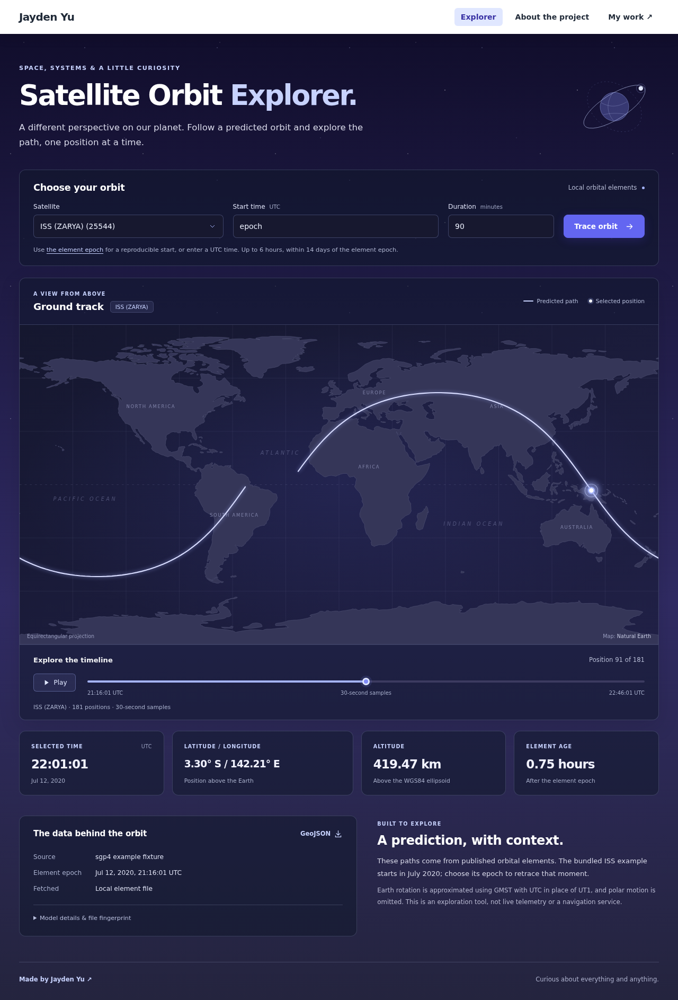

# Satellite Orbit Explorer

Reproducible satellite predictions in Rust: validated TLE input → SGP4 → TEME states → geodetic ground tracks → a small offline browser map.

**MVP status:** local CLI, API, browser demo, and cached provider adapter implemented. Numerical tests compare 668 reference cases (including expected failures) from the Vallado/CelesTrak verification dataset distributed with `sgp4` 2.4.0. The UI is a visualization of predictions, not live telemetry or a navigation tool.



## Run it

Install a current stable Rust toolchain (tested with Rust 1.98.1), then:

```sh
cargo build --release --locked
./target/release/orbit-track inspect --tle fixtures/iss.tle
./target/release/orbit-track predict --tle fixtures/iss.tle --start epoch --minutes 90 --step-seconds 30 --format json
./target/release/orbit-track serve --data fixtures
```

Open <http://127.0.0.1:8788>. The ISS fixture is historical, with an epoch in July 2020. `epoch` deliberately starts the demo at that epoch; it does not claim to show the ISS today. Select a satellite, predict a track, and move the slider between computed samples. The basemap uses bundled Natural Earth coastlines and a graticule: no CDN, tile service, or network request is needed. The white navigation, indigo controls, translucent cards, and night-sky background match the accompanying personal website. Play/pause steps through the existing samples (one sample per 150 ms); it stops at the end of the track or when you move the slider.

For GeoJSON or optional TEME states:

```sh
./target/release/orbit-track predict --tle fixtures/iss.tle --format geojson > track.geojson
./target/release/orbit-track predict --tle fixtures/iss.tle --teme > states.json
```

JSON exposes `latitude_deg`, `longitude_deg`, `altitude_km`, UTC time, signed element age, and provenance. GeoJSON is a `MultiLineString` split at the date line, with altitude in **meters** per RFC 7946; a zero-duration prediction is a `Point`. Boundary interpolation is for display only.

## Use current elements

```sh
./target/release/orbit-track fetch --provider celestrak --catalog-id 25544 --output data/iss.tle
./target/release/orbit-track serve --data data
```

A fetch stores immutable content-addressed input and provenance in `.orbit-cache/`, and writes an active `.tle` file with a `.meta.json` sidecar. Fetch time and element epoch are distinct. Matching digests are validated on load. The six-hour local cache avoids repeated provider downloads; serving a page never triggers a fetch. Restart `serve` after changing the local catalog.

On refresh failure, the command fails and preserves the active output. `--allow-stale` explicitly permits an existing valid cached set and records a visible warning. No cached set means an error. HTTP errors, invalid TLEs, and a wrong satellite ID are never accepted as a successful fresh fetch.

**Live CelesTrak access was unavailable in the implementation environment.** The adapter and failure policy were verified against a local HTTP provider. Review [CelesTrak's current data-access guidance](https://celestrak.org/NORAD/elements/) before scheduling downloads; the six-hour policy is a local initial policy, not a claim of provider approval. The MVP does not schedule downloads or retry provider errors automatically. A killed fetch may leave `fetch.lock`; remove that lock only after confirming no fetch process is active. Completed immutable cache entries survive interrupted active-output publication. Readers reject a digest mismatch rather than using a mixed `.tle`/metadata pair.

## Numerical contract

- `sgp4` **2.4.0**, pinned exactly; WGS72 gravity constants; AFSPC compatibility initialization and propagation.
- SGP4 positions/velocities are **TEME**, in km and km/s. They are not Earth-fixed coordinates.
- Ground tracks rotate TEME by IAU-1982 GMST, approximate UT1 with UTC, and omit polar motion. Geodetic coordinates use the WGS84 ellipsoid.
- Longitude is `[-180, 180)`, except duplicated ±180° display boundary points in GeoJSON.
- UTC RFC3339 timestamps must have an explicit offset; `epoch` is supported. No local timezone inference.
- Requests allow 0–360 minutes, 10–21,600-second steps, at most 2,161 samples, and times within ±14 days of the element epoch. The step must divide nonzero duration exactly; both endpoints are included.
- A warning appears beyond 72 hours from the epoch. This threshold and the 14-day bound are product limits, **not accuracy guarantees**. Age is shown even when no warning applies.
- Invalid/nonfinite or below-ellipsoid states are errors, never successful zero/NaN positions.

See [reference provenance and conventions](docs/numerics.md) and [measured validation](docs/validation.md). Reference agreement validates this model/configuration; it does not establish agreement with a satellite's actual position.

## Local HTTP API

| Endpoint | Behavior |
| --- | --- |
| `/healthz` | Process health |
| `/v1/satellites` | Loaded catalog and provenance |
| `/v1/satellites/25544/position?at=epoch` | One prediction with full metadata |
| `/v1/satellites/25544/track?start=epoch&minutes=90&step_seconds=30` | Inclusive, bounded ground track |

Track options: `format=json|geojson`, `teme=true|false`. Errors carry `error.code` and `error.message`; missing catalog IDs return 404. Input errors return 400. Data directories accept one two/three-line `.tle` file per numeric catalog ID, with an optional metadata sidecar. Duplicate IDs and malformed input fail startup rather than silently selecting a dataset.

The service loads files once at startup and binds only loopback addresses. For a devserver, run `ssh -N -L 8788:127.0.0.1:8788 USER@HOST` on your own computer, then use the localhost URL.

## Tests and benchmarks

```sh
cargo test --locked
cargo fmt --check
cargo clippy --locked --all-targets -- -D warnings
cargo run --release --locked --example benchmark
python3 scripts/measure-http.py  # start the fixture server first
```

`scripts/browser-check.mjs` uses Playwright to check the demo, slider, date-line split, stale warning, invalid time, second satellite, and narrow viewport. `docs/` contains captured screenshots and measurements.

One Cargo package separates `core`, `frames`, `data`, `api`, and CLI modules; the numerical core does not depend on the HTTP framework. The UI is plain JavaScript served from the same binary. Map data, attribution, and optional build-time regeneration instructions are in [assets/README.md](assets/README.md). Pass predictions, maneuvers, collision analysis, constellation-scale queries, and live telemetry are outside this MVP.

MIT licensed; copied orbital fixtures/reference vectors retain the upstream notice in `fixtures/SGP4-LICENSE`. This project is unaffiliated with NASA, CelesTrak, or the `sgp4` maintainers.
