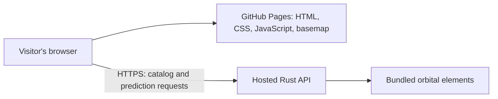

# Host the explorer on jiafengyu.github.io

The browser renders the map and handles controls/playback. The Rust API owns TLE parsing, provenance checks, SGP4 propagation, coordinate conversion, request limits, warning classification, and GeoJSON generation. A single `format=explorer` request returns both the samples and GeoJSON, calculated once.



GitHub Pages hosts static files; the Rust process runs on a separate host. No Rust/WASM or SGP4 implementation is shipped to the browser. The existing CLI and same-origin local server still work.

## Deploy the backend on Render

1. Push this repository's `main` branch to `JiaFengYu/orbit-track`.
2. In Render, create a **Blueprint** connected to that repository and select `render.yaml`. Review and create the `orbit-track-api` web service. The blueprint requests the free plan, uses the Dockerfile, and checks `/healthz`. No service was created by preparing these files.
3. Wait for the deploy to become healthy. Copy the actual HTTPS URL Render assigns, for example `https://YOUR-SERVICE.onrender.com`. The hostname is not known before creation.
4. Open `https://YOUR-SERVICE.onrender.com/healthz` and confirm `{"service":"orbit-track","status":"ok"}`. Open `/v1/satellites` and confirm the catalog loads.

`ORBIT_ALLOWED_ORIGINS` is set to `https://jiafengyu.github.io`. This is an exact origin, with no path. Multiple origins can be comma-separated for previews. CORS permits browser reads from those origins; the API itself is public and requires no credentials. The service accepts only the existing bounded prediction requests, with at most eight predictions in flight and a retryable 503 when busy. It never downloads provider data in response to a visitor.

Render terminates HTTPS; the container listens on `0.0.0.0:$PORT`. The process runs as a non-root user and shuts down on SIGTERM. Automatic deploys are disabled in the blueprint: deploy a tested commit manually, or enable automatic deploys once your checks are established. If your host suspends idle services, the first visitor must wait for it to start; the UI shows connection progress, waits up to 90 seconds, and offers a reconnect button after failure.

The container includes the historical ISS and Vanguard fixtures with their source metadata. These are reproducible examples, not current tracking data. To use updated elements, prepare validated `.tle`/`.meta.json` files using the existing CLI and deploy a replacement catalog via `ORBIT_DATA_DIR` and a mount or image update. The service loads the catalog on startup. No scheduled refresh is implemented.

## Connect the official website

The website changes are prepared in `/data/users/jaydenyu/personal-website`; the deployment repository remains **JiaFengYu/JiaFengYu.github.io**. Apply the accompanying `orbit-hosting-update.patch` in a clean official-site checkout that already has the previous explorer update. Use `git apply --check` first and reconcile any changes to that baseline before applying.

In that repository on GitHub, open **Settings → Secrets and variables → Actions → Variables → New repository variable**:

```text
Name:  ORBIT_API_URL
Value: https://YOUR-SERVICE.onrender.com
```

Use the actual backend URL, without a path. This is a public URL, not a secret or token. The updated Pages workflow passes it to the build as `NEXT_PUBLIC_ORBIT_API_URL`. Push the website changes or run **Deploy GitHub Pages** again after setting the variable.

The deployed explorer is available at `https://jiafengyu.github.io/orbit-explorer/`. The Satellite Orbit Explorer project page gains an **Open interactive explorer** button when the API URL is configured. Its static URL also works with `/orbit-explorer/index.html`. With no API URL, the launch button stays hidden and a direct visit explains that the demo is not available yet. Nothing silently connects to a visitor's localhost.

Verify the live page loads the catalog, traces an orbit, plays the timeline, downloads GeoJSON, and works on a phone. A successful website build cannot establish that the remote backend is healthy or that its CORS configuration is correct.

## Other hosts

The Dockerfile works with a host that provides an HTTPS endpoint and a port environment variable. Set `ORBIT_ALLOWED_ORIGINS=https://jiafengyu.github.io` and use `/healthz` as its health check. The backend does not require a database or writable disk for the bundled demo.

```sh
docker build -t orbit-track .
docker run --rm -p 127.0.0.1:10000:10000 \
  -e ORBIT_ALLOWED_ORIGINS=http://127.0.0.1:8792 orbit-track
```

For a native hosted process, explicitly pass `--allow-public` with your listener. Local runs continue to bind only loopback by default.

## Reproduce the separate-origin browser checks

From this repository, start the native API in one terminal:

```sh
cargo build --release --locked
./target/release/orbit-track serve --data fixtures --listen 127.0.0.1:8791 \
  --allowed-origin http://127.0.0.1:8792
```

In a second terminal:

```sh
python3 scripts/export-web.py --output /tmp/orbit-static/orbit-explorer --api-url http://127.0.0.1:8791
python3 -m http.server 8792 --bind 127.0.0.1 --directory /tmp/orbit-static
```

With Playwright and Chromium installed, run:

```sh
DEMO_URL=http://127.0.0.1:8792/orbit-explorer/ EVIDENCE_PREFIX=hosted-explorer node scripts/browser-check.mjs
DEMO_URL=http://127.0.0.1:8792/orbit-explorer/ API_URL=http://127.0.0.1:8791 node scripts/hosting-check.mjs
```

The second check verifies real browser CORS, one combined request per submission, recovery after an initial connection failure, preservation of the previous map during an outage, and the unconfigured deployment state. For a remote devserver, forward **both** ports to your computer.

## Updating the website's UI copy

The website vendors just the small browser assets. After changing `web/`, refresh them from this repository:

```sh
python3 scripts/export-web.py --output /path/to/JiaFengYu.github.io/public/orbit-explorer
```

The website's `prebuild` script writes the deployment API URL. Commit the refreshed browser assets to the website repository and push both repositories as needed. API/backend updates and static website updates have separate deployment lifecycles; committing to one does not automatically publish the other.
