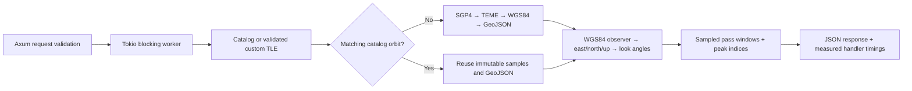

# Rust orbit reuse: measured performance

Changing a ground station changes the view of an orbit, not the orbit itself. The Rust backend caches immutable SGP4 samples and GeoJSON, then recomputes observer geometry for the selected latitude, longitude, and clearance angle.

Measured on **2026-10-28 PDT**, in a release build on an **AMD EPYC 9654**, Rust 1.98.1. These are local process timings, including the handler and JSON encoding. They exclude HTTP, TLS, Render startup, browser work, and catalog loading.

| Positions | Window / interval | Fresh orbit median | Reused orbit median | Reduction | Speedup |
| --- | --- | --- | --- | --- | --- |
| 181 | 90 minutes / 30 seconds | 0.402 ms | 0.238 ms | 40.7% | 1.69× |
| 721 | 6 hours / 30 seconds | 1.411 ms | 0.801 ms | 43.3% | 1.76× |
| 2,161 | 6 hours / 10 seconds | 4.307 ms | 2.479 ms | 42.5% | 1.74× |

This measures reuse within the Rust implementation. It does **not** compare Rust with Python or JavaScript, claim deployed Render latency, or establish maximum server capacity. The browser's round-trip time includes additional work and is displayed separately in the UI.

## Method

[`examples/explorer_benchmark.rs`](../examples/explorer_benchmark.rs) runs **400 paired requests per workload**, following 20 warmup pairs. Each pair has identical input: an initialized ISS element set, the same time window, and a changing observer latitude. The fresh variant starts with an empty orbit cache; the reused variant has one matching orbit cached. Construction of the empty Explorer and catalog/TLE loading are outside the timer. The fresh path includes normal cache insertion. Both variants include observer analysis, response assembly, and final JSON encoding.

The benchmark alternates variant order to reduce ordering effects. It compares the complete track, GeoJSON, observer analysis, and orbital metadata exactly on every pair. Timing and cache metadata are deliberately excluded from equality. Raw samples, p95 values, environment, input fingerprint, and measured source hashes are in [`explorer-benchmark.json`](explorer-benchmark.json). The development machine is shared, so these are results from this run, not guaranteed latency bounds.

```sh
cargo run --release --locked --example explorer_benchmark > /tmp/explorer-benchmark.json
```

An optional first argument changes the iteration count (minimum 10). The committed report also includes source-file SHA-256 values recorded with this run.

## Where Rust does the work



- `core.rs` validates TLEs, initializes SGP4 constants, applies time/sample bounds, propagates states, and produces provenance-bearing tracks.
- `frames.rs` handles Earth rotation, WGS84 coordinates, and display-only date-line splitting.
- `observer.rs` computes elevation, azimuth, range, and sampled pass windows. No orbit math is duplicated in the browser.
- `explorer.rs` reuses `Arc`-owned orbit data through an LRU cache bounded to **32 tracks and 32,768 positions**. It only locks the cache for lookups/insertion; propagation and observer math run outside the mutex. Keys include the element digest, canonical start time, duration, and sample interval. Observer coordinates are excluded because they do not change propagation. Custom TLEs bypass the cache and are not saved.
- `api.rs` exposes bounded JSON requests with exact-origin CORS and at most eight concurrent predictions. The old GET APIs remain compatible.
- The browser draws the returned coordinates, charts and pass controls, and plays existing samples. It submits one request per change rather than polling every animation frame.

The per-request UI's **Rust handler** metric stops after response assembly; it excludes final JSON encoding, queueing, and network transit. The offline benchmark above additionally measures final JSON encoding. These are explicitly different scopes.

## Scientific limits

Passes describe sampled geometric clearance, not visibility to the human eye. There is no sunlight, atmospheric refraction, terrain, or obstruction model. Short passes can fall between samples; boundaries are not interpolated rise/set events, and windows touching either end are marked clipped. Azimuth is undefined directly overhead or below the observer. Earth orientation retains the existing approximate GMST convention.

The six bundled inputs are historical examples with individual epochs, copied from the documented SGP4 verification sources. They are not a current satellite catalog. Pasted TLEs are validated on the server and bounded by the same 14-day and 2,161-sample limits.
